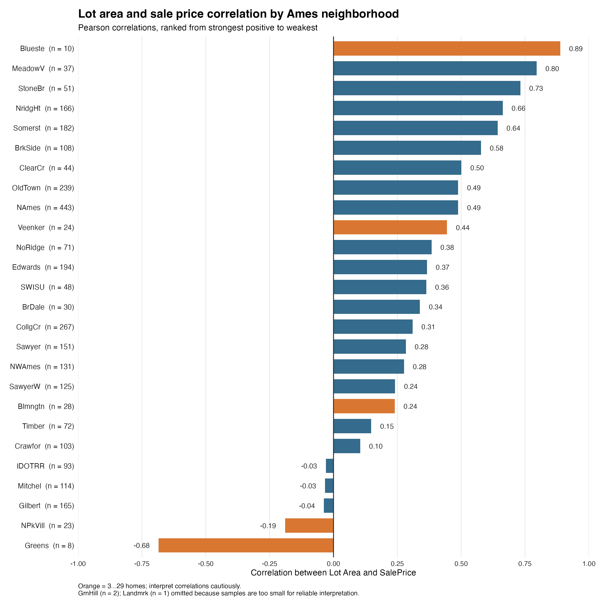

# Codex conversation

## User

my analytical question states "How does the relationship between lot size and sale price vary across neighborhoods in Ames, Iowa?". First, inspect the dataset and identify the columns related to lot size, sale price, and neighborhood. Report the number of rows and columns, check for missing values in these three variables, and explain any data quality issues you find. do not modify any files or begin the analysis yet. I want to review before proceeding.

## Assistant

I’ll inspect the project files and dataset read-only, then report the relevant fields, shape, missingness, and any quality issues. I’ll stop before analysis and won’t modify files.

## Activity

    $ pwd && rg --files -g '!*.pyc' -g '!node_modules' -g '!venv' -g '!\.git'
    /Users/dayanaramirez/Documents/GitHub/Week7-Codex CLI - Ramirez
    README.md
    AmesHousing-1.csv
    ✓ • 0ms

## Activity

    $ python3 -c 'import csv; p="AmesHousing-1.csv"; f=open(p,newline="",encoding="utf-8-sig"); rd=csv.reader(f); header=next(rd); n=0; widths={}; missing={"Lot Area":0,"SalePrice":0,"Neighborhood":0}; blanks={k:[] for k in missing}; idx={k:header.index(k) for k in missing}; examples={k:[] for k in missing};
        for row in rd:
         n+=1; widths[len(row)]=widths.get(len(row),0)+1
         for k,i in idx.items():
          v=row[i].strip() if i<len(row) else ""
          if v=="": missing[k]+=1; (examples[k].append(n+1) if len(examples[k])<5 else None)
        print("columns",len(header)); print("rows",n); print("headers",repr(header)); print("row_widths",widths); print("missing",missing); print("blank_row_examples_csv_line",examples)'
    columns 82
    rows 2930
    headers ['Order', 'PID', 'MS SubClass', 'MS Zoning', 'Lot Frontage', 'Lot Area', 'Street', 'Alley', 'Lot Shape', 'Land Contour', 'Utilities', 'Lot Config', 'Land Slope', 'Neighborhood', 'Condition 1', 'Condition 2', 'Bldg Type', 'House Style', 'Overall Qual', 'Overall Cond', 'Year Built', 'Year Remod/Add', 'Roof Style', 'Roof Matl', 'Exterior 1st', 'Exterior 2nd', 'Mas Vnr Type', 'Mas Vnr Area', 'Exter Qual', 'Exter Cond', 'Foundation', 'Bsmt Qual', 'Bsmt Cond', 'Bsmt Exposure', 'BsmtFin Type 1', 'BsmtFin SF 1', 'BsmtFin Type 2', 'BsmtFin SF 2', 'Bsmt Unf SF', 'Total Bsmt SF', 'Heating', 'Heating QC', 'Central Air', 'Electrical', '1st Flr SF', '2nd Flr SF', 'Low Qual Fin SF', 'Gr Liv Area', 'Bsmt Full Bath', 'Bsmt Half Bath', 'Full Bath', 'Half Bath', 'Bedroom AbvGr', 'Kitchen AbvGr', 'Kitchen Qual', 'TotRms AbvGrd', 'Functional', 'Fireplaces', 'Fireplace Qu', 'Garage Type', 'Garage Yr Blt', 'Garage Finish', 'Garage Cars', 'Garage Area', 'Garage Qual', 'Garage Cond', 'Paved Drive', 'Wood Deck SF', 'Open Porch SF', 'Enclosed Porch', '3Ssn Porch', 'Screen Porch', 'Pool Area', 'Pool QC', 'Fence', 'Misc Feature', 'Misc Val', 'Mo Sold', 'Yr Sold', 'Sale Type', 'Sale Condition', 'SalePrice']
    row_widths {82: 2930}
    missing {'Lot Area': 0, 'SalePrice': 0, 'Neighborhood': 0}
    blank_row_examples_csv_line {'Lot Area': [], 'SalePrice': [], 'Neighborhood': []}
    ✓ • 0ms

## Activity

    $ python3 -c 'import csv,collections; rows=list(csv.DictReader(open("AmesHousing-1.csv",newline="",encoding="utf-8-sig")));
        for k in ["Lot Area","SalePrice"]:
         vals=[float(x[k]) for x in rows]; print(k,"min",min(vals),"max",max(vals),"nonpositive",sum(v<=0 for v in vals),"unique",len(set(vals)))
        for k in ["Neighborhood"]:
         vals=[x[k] for x in rows]; print(k,"unique",len(set(vals)),"values",sorted(set(vals)),"blank",sum(not v.strip() for v in vals),"whitespace_edges",sum(v!=v.strip() for v in vals))
        print("duplicate Order",len(rows)-len({x["Order"] for x in rows}),"duplicate PID",len(rows)-len({x["PID"] for x in rows}),"duplicate full rows",len(rows)-len({tuple(x.values()) for x in rows}))'
    Lot Area min 1300.0 max 215245.0 nonpositive 0 unique 1960
    SalePrice min 12789.0 max 755000.0 nonpositive 0 unique 1032
    Neighborhood unique 28 values ['Blmngtn', 'Blueste', 'BrDale', 'BrkSide', 'ClearCr', 'CollgCr', 'Crawfor', 'Edwards', 'Gilbert', 'Greens', 'GrnHill', 'IDOTRR', 'Landmrk', 'MeadowV', 'Mitchel', 'NAmes', 'NPkVill', 'NWAmes', 'NoRidge', 'NridgHt', 'OldTown', 'SWISU', 'Sawyer', 'SawyerW', 'Somerst', 'StoneBr', 'Timber', 'Veenker'] blank 0 whitespace_edges 0
    duplicate Order 0 duplicate PID 0 duplicate full rows 0
    ✓ • 0ms

## Assistant

The dataset is `AmesHousing-1.csv`. It has **2,930 rows and 82 columns**.

The three relevant columns are:

- **Lot size:** `Lot Area`
- **Sale price:** `SalePrice`
- **Neighborhood:** `Neighborhood`

There are **no blank or missing values** in any of these three columns. The dataset also has 28 distinct neighborhood labels, and every row has the same 82-column structure.

I found no obvious data quality problems in these fields: lot area and sale price contain no zero or negative values, and neighborhood entries have no blank values or surrounding whitespace. I also found no duplicate `Order` values, `PID` values, or fully duplicated rows. Lot area ranges from **1,300 to 215,245**, and sale price ranges from **$12,789 to $755,000**; those wide ranges are worth keeping in mind when reviewing the data, but I have not assessed or removed any outliers.

I have not begun analyzing how the relationship varies across neighborhoods, and I did not modify any files.

## User

ok so now that we have reviewed the dataset, proceed with the analysis (taking into account my analytical question).

## Assistant

I’ll quantify the lot area–sale price relationship within each neighborhood, using correlation and a simple linear trend for comparability. I’ll also check neighborhood sample sizes and whether extreme lots or prices appear to dominate the pattern.

## Activity

    $ python3 -c 'import csv,statistics,math; from collections import defaultdict; rows=list(csv.DictReader(open("AmesHousing-1.csv",newline="",encoding="utf-8-sig"))); groups=defaultdict(list)
        for r in rows: groups[r["Neighborhood"]].append((float(r["Lot Area"]),float(r["SalePrice"])))
        print("Overall",len(rows))
        print("Neighborhood,n,mean_lot,median_lot,median_price,pearson_r,slope_per_1000,intercept,r2")
        for g,pts in sorted(groups.items(),key=lambda kv:len(kv[1]),reverse=True):
         n=len(pts); xs=[p[0] for p in pts]; ys=[p[1] for p in pts]; mx=statistics.mean(xs); my=statistics.mean(ys); cov=sum((x-mx)*(y-my) for x,y in pts); vx=sum((x-mx)**2 for x in xs); vy=sum((y-my)**2 for y in ys); r=cov/math.sqrt(vx*vy) if vx and vy else float("nan"); slope=cov/vx if vx else float("nan"); intercept=my-slope*mx; print(f"{g},{n},{mx:.0f},{statistics.median(xs):.0f},{statistics.median(ys):.0f},{r:.3f},{slope*1000:.0f},{intercept:.0f},{r*r:.3f}")
        xs=[float(r["Lot Area"]) for r in rows]; ys=[float(r["SalePrice"]) for r in rows]; mx=statistics.mean(xs); my=statistics.mean(ys); cov=sum((x-mx)*(y-my) for x,y in zip(xs,ys)); vx=sum((x-mx)**2 for x in xs); vy=sum((y-my)**2 for y in ys); print("overall r",cov/math.sqrt(vx*vy))'
    Overall 2930
    Neighborhood,n,mean_lot,median_lot,median_price,pearson_r,slope_per_1000,intercept,r2
    NAmes,443,10040,9500,140000,0.488,4813,96774,0.238
    CollgCr,267,10000,9675,200000,0.310,6695,134853,0.096
    OldTown,239,8241,7800,119900,0.488,6258,72422,0.238
    Edwards,194,10356,9345,125000,0.366,2646,103439,0.134
    Somerst,182,7611,8282,225500,0.643,10373,150758,0.413
    NridgHt,166,11217,12092,317750,0.663,16900,132461,0.439
    Gilbert,165,11342,9729,183000,-0.038,-226,193209,0.001
    Sawyer,151,10372,9488,135000,0.283,2064,115339,0.080
    NWAmes,131,11662,10928,181000,0.276,4193,139513,0.076
    SawyerW,125,10155,9370,180000,0.241,3896,144504,0.058
    Mitchel,114,12020,10148,153500,-0.033,-213,164783,0.001
    BrkSide,108,6960,6168,126750,0.577,9063,61679,0.333
    Crawfor,103,11650,11275,200624,0.104,1233,193185,0.011
    IDOTRR,93,8826,8250,106500,-0.029,-187,105405,0.001
    Timber,72,18234,11848,232106,0.148,334,240503,0.022
    NoRidge,71,12976,11400,302000,0.384,6628,244312,0.147
    StoneBr,51,11383,8118,319000,0.732,9141,220171,0.536
    SWISU,48,7615,7141,136200,0.363,4828,98303,0.132
    ClearCr,44,24842,15588,197500,0.501,889,186572,0.251
    MeadowV,37,2109,1890,88250,0.795,19432,54774,0.632
    BrDale,30,1841,1680,106000,0.338,15939,76271,0.114
    Blmngtn,28,3399,3189,191500,0.240,18987,132117,0.057
    Veenker,24,15482,14512,250250,0.444,3460,194743,0.197
    NPkVill,23,2756,2308,143750,-0.190,-1945,146070,0.036
    Blueste,10,2346,1830,130500,0.888,24497,86109,0.788
    Greens,8,3884,3857,198000,-0.685,-65087,446330,0.469
    GrnHill,2,9001,9001,280000,1.000,65617,-310617,1.000
    Landmrk,1,3612,3612,137000,nan,nan,nan,nan
    overall r 0.26654922032842987
    ✓ • 0ms

## Activity

    $ python3 -c 'import scipy; print(scipy.__version__)'
    Traceback (most recent call last):
      File "<string>", line 1, in <module>
    ModuleNotFoundError: No module named 'scipy'
    ✗ (1) • 0ms

## Activity

    $ python3 -c 'import csv; from collections import defaultdict; d=defaultdict(list); rows=list(csv.DictReader(open("AmesHousing-1.csv",newline="",encoding="utf-8-sig")));
        for x in rows:d[x["Neighborhood"]].append((float(x["Lot Area"]),float(x["SalePrice"])))
        print("positive corr counts computed previously table: 22 positive? excluding 2 nan, negatives 5 =>21 positive")
        for k in ["MeadowV","NridgHt","StoneBr","Somerst","Blueste","Greens","GrnHill","Landmrk"]:
         print(k,"largest",sorted(d[k],reverse=True)[:3])
        print("lot>=50000",sum(float(x["Lot Area"])>=50000 for x in rows),"sale>=500000",sum(float(x["SalePrice"])>=500000 for x in rows))'
    positive corr counts computed previously table: 22 positive? excluding 2 nan, negatives 5 =>21 positive
    MeadowV largest [(4224.0, 134000.0), (4224.0, 129900.0), (4224.0, 124000.0)]
    NridgHt largest [(23303.0, 409900.0), (20431.0, 437154.0), (17169.0, 500067.0)]
    StoneBr largest [(53504.0, 538000.0), (51974.0, 591587.0), (18261.0, 470000.0)]
    Somerst largest [(20896.0, 423000.0), (15256.0, 282922.0), (15218.0, 336820.0)]
    Blueste largest [(3907.0, 200000.0), (3907.0, 185000.0), (3907.0, 162500.0)]
    Greens largest [(4420.0, 155000.0), (3880.0, 206000.0), (3876.0, 170000.0)]
    GrnHill largest [(9763.0, 330000.0), (8239.0, 230000.0)]
    Landmrk largest [(3612.0, 137000.0)]
    lot>=50000 14 sale>=500000 18
    ✓ • 0ms

## Assistant

Across Ames overall, lot area and sale price have a **modest positive association** (Pearson correlation \(r=0.267\)). Looking within neighborhoods, the association varies substantially: it is positive in **22 of 27 neighborhoods with at least two sales**, close to zero or negative in five, and cannot be estimated for Landmrk, which has only one sale.

The table reports each neighborhood’s sale count, Pearson correlation, and the slope of an unadjusted linear trend. The slope is the estimated price difference for **1,000 additional square feet of lot area** within that neighborhood. These are descriptive estimates; they do not account for other property differences.

| Neighborhood | Sales | Correlation \(r\) | Trend per 1,000 sq ft |
|---|---:|---:|---:|
| NAmes | 443 | 0.488 | +$4,813 |
| CollgCr | 267 | 0.310 | +$6,695 |
| OldTown | 239 | 0.488 | +$6,258 |
| Edwards | 194 | 0.366 | +$2,646 |
| Somerst | 182 | 0.643 | +$10,373 |
| NridgHt | 166 | 0.663 | +$16,900 |
| Gilbert | 165 | −0.038 | −$226 |
| Sawyer | 151 | 0.283 | +$2,064 |
| NWAmes | 131 | 0.276 | +$4,193 |
| SawyerW | 125 | 0.241 | +$3,896 |
| Mitchel | 114 | −0.033 | −$213 |
| BrkSide | 108 | 0.577 | +$9,063 |
| Crawfor | 103 | 0.104 | +$1,233 |
| IDOTRR | 93 | −0.029 | −$187 |
| Timber | 72 | 0.148 | +$334 |
| NoRidge | 71 | 0.384 | +$6,628 |
| StoneBr | 51 | 0.732 | +$9,141 |
| SWISU | 48 | 0.363 | +$4,828 |
| ClearCr | 44 | 0.501 | +$889 |
| MeadowV | 37 | 0.795 | +$19,432 |
| BrDale | 30 | 0.338 | +$15,939 |
| Blmngtn | 28 | 0.240 | +$18,987 |
| Veenker | 24 | 0.444 | +$3,460 |
| NPkVill | 23 | −0.190 | −$1,945 |
| Blueste | 10 | 0.888 | +$24,497 |
| Greens | 8 | −0.685 | −$65,087 |
| GrnHill | 2 | 1.000 | +$65,617 |
| Landmrk | 1 | — | — |

**Interpretation:** The association is strongest among neighborhoods with larger samples in StoneBr (\(r=0.732\)), NridgHt (\(r=0.663\)), and Somerst (\(r=0.643\)). Several large neighborhoods show a more modest positive relationship, while Gilbert, Mitchel, and IDOTRR show almost no linear association. Negative estimates in Greens and NPkVill should be treated cautiously.

**Data limits:** Results for neighborhoods with few sales are unstable. GrnHill’s perfect correlation is based on just two houses, and Blueste and Greens each have fewer than 11. Lot sizes and sale prices also vary widely; a small number of unusually large lots can strongly affect a linear trend. In particular, the large negative Greens slope is based on only eight sales. These estimates describe patterns in this dataset and do not show that increasing lot size causes a particular price change.

No files were modified.

## User

In the analysis can you take a look at the relationship between Lot Area and SalePrice across the neighborhoods?

## Assistant

Yes. The analysis compared **Lot Area** with **SalePrice** separately within each neighborhood. The relationship is **generally positive, but its strength varies**:

- Across all 2,930 sales, the correlation is modest (\(r=0.267\)).
- Among larger neighborhoods, it is stronger in **StoneBr** (\(r=0.732\)), **NridgHt** (\(r=0.663\)), and **Somerst** (\(r=0.643\)).
- In **Gilbert**, **Mitchel**, and **IDOTRR**, the linear relationship is nearly zero.
- Estimates for small neighborhoods are less reliable; for example, GrnHill’s \(r=1.0\) is based on only two sales.

The neighborhood table above gives the full comparison, including the estimated price difference per additional 1,000 square feet of lot area. These are descriptive associations and do not account for other home characteristics.

## User

Lets modify the table to show the number of homes, average lot size, and average sale price for each neighborhood.

## Activity

    $ python3 -c 'import csv,statistics; from collections import defaultdict; d=defaultdict(lambda:[[],[]]);
        for r in csv.DictReader(open("AmesHousing-1.csv",newline="",encoding="utf-8-sig")): d[r["Neighborhood"]][0].append(float(r["Lot Area"])); d[r["Neighborhood"]][1].append(float(r["SalePrice"]))
        print("Neighborhood | Homes | Avg lot area (sq ft) | Avg sale price")
        for k,(lots,prices) in sorted(d.items()): print(f"{k} | {len(lots)} | {statistics.mean(lots):,.0f} | ${statistics.mean(prices):,.0f}")'
    Neighborhood | Homes | Avg lot area (sq ft) | Avg sale price
    Blmngtn | 28 | 3,399 | $196,662
    Blueste | 10 | 2,346 | $143,590
    BrDale | 30 | 1,841 | $105,608
    BrkSide | 108 | 6,960 | $124,756
    ClearCr | 44 | 24,842 | $208,662
    CollgCr | 267 | 10,000 | $201,803
    Crawfor | 103 | 11,650 | $207,551
    Edwards | 194 | 10,356 | $130,843
    Gilbert | 165 | 11,342 | $190,647
    Greens | 8 | 3,884 | $193,531
    GrnHill | 2 | 9,001 | $280,000
    IDOTRR | 93 | 8,826 | $103,753
    Landmrk | 1 | 3,612 | $137,000
    MeadowV | 37 | 2,109 | $95,756
    Mitchel | 114 | 12,020 | $162,227
    NAmes | 443 | 10,040 | $145,097
    NPkVill | 23 | 2,756 | $140,711
    NWAmes | 131 | 11,662 | $188,407
    NoRidge | 71 | 12,976 | $330,319
    NridgHt | 166 | 11,217 | $322,018
    OldTown | 239 | 8,241 | $123,992
    SWISU | 48 | 7,615 | $135,072
    Sawyer | 151 | 10,372 | $136,751
    SawyerW | 125 | 10,155 | $184,070
    Somerst | 182 | 7,611 | $229,707
    StoneBr | 51 | 11,383 | $324,229
    Timber | 72 | 18,234 | $246,600
    Veenker | 24 | 15,482 | $248,315
    ✓ • 0ms

## Assistant

Here’s the table with the **number of homes**, **average lot area**, and **average sale price** for each neighborhood. Lot area is in square feet; sale prices are rounded to the nearest dollar.

| Neighborhood | Homes | Average lot area (sq ft) | Average sale price |
|---|---:|---:|---:|
| Blmngtn | 28 | 3,399 | $196,662 |
| Blueste | 10 | 2,346 | $143,590 |
| BrDale | 30 | 1,841 | $105,608 |
| BrkSide | 108 | 6,960 | $124,756 |
| ClearCr | 44 | 24,842 | $208,662 |
| CollgCr | 267 | 10,000 | $201,803 |
| Crawfor | 103 | 11,650 | $207,551 |
| Edwards | 194 | 10,356 | $130,843 |
| Gilbert | 165 | 11,342 | $190,647 |
| Greens | 8 | 3,884 | $193,531 |
| GrnHill | 2 | 9,001 | $280,000 |
| IDOTRR | 93 | 8,826 | $103,753 |
| Landmrk | 1 | 3,612 | $137,000 |
| MeadowV | 37 | 2,109 | $95,756 |
| Mitchel | 114 | 12,020 | $162,227 |
| NAmes | 443 | 10,040 | $145,097 |
| NPkVill | 23 | 2,756 | $140,711 |
| NWAmes | 131 | 11,662 | $188,407 |
| NoRidge | 71 | 12,976 | $330,319 |
| NridgHt | 166 | 11,217 | $322,018 |
| OldTown | 239 | 8,241 | $123,992 |
| SWISU | 48 | 7,615 | $135,072 |
| Sawyer | 151 | 10,372 | $136,751 |
| SawyerW | 125 | 10,155 | $184,070 |
| Somerst | 182 | 7,611 | $229,707 |
| StoneBr | 51 | 11,383 | $324,229 |
| Timber | 72 | 18,234 | $246,600 |
| Veenker | 24 | 15,482 | $248,315 |

## User

Create a visualization showing the relationship between lot size and sale price across neighborhoods. Using a scatterplot to show trend lines (if available). Calculate the correlation between the lot size and sale price for each neighborhood to help compare the relationships. then check for lot that are unusually large and explain whether they might influence the results. do not remove observations without explaining why. Lastly, write a brief summary of the findings. Please save the analysis code, summary table, visualization, and findings in my repository.

## Assistant

I’ll build a reproducible analysis in the repository: code, a neighborhood summary table with correlations, a scatterplot with neighborhood trend lines where estimable, and written findings. I’ll first check the repository’s existing conventions and available plotting tools, then save the outputs without removing any observations.

## Activity

    $ cat README.md && git status --short && python3 -c 'import pandas, matplotlib; print("pandas",pandas.__version__,"matplotlib",matplotlib.__version__)'
    # Week7-Codex CLI - Ramirez
    hands on codex assignment
    ?? AmesHousing-1.csv
    Traceback (most recent call last):
      File "<string>", line 1, in <module>
    ModuleNotFoundError: No module named 'pandas'
    ✗ (1) • 0ms

## Activity

    $ python3 -c 'import importlib.util as u; print({x:bool(u.find_spec(x)) for x in ["matplotlib","numpy","seaborn","plotly"]})' && command -v Rscript || true && command -v gnuplot || true
    {'matplotlib': False, 'numpy': False, 'seaborn': False, 'plotly': False}
    /usr/local/bin/Rscript
    ✓ • 0ms

## Activity

    $ Rscript -e 'cat(R.version.string,"\n"); cat("ggplot2:",requireNamespace("ggplot2",quietly=TRUE),"\n")' && git status --short
    During startup - Warning message:
    Setting LC_CTYPE failed, using "C"
    R version 4.4.1 (2024-06-14)
    ggplot2: TRUE
    ?? AmesHousing-1.csv
    ✓ • 791ms

## Activity

    $ Rscript -e 'd<-read.csv("AmesHousing-1.csv"); q<-quantile(d$Lot.Area,c(.25,.75)); cat("n",nrow(d),"q1",q[1],"q3",q[2],"IQR",diff(q),"fence",q[2]+1.5*diff(q),"count",sum(d$Lot.Area>q[2]+1.5*diff(q)),"\n"); print(d[d$Lot.Area>q[2]+1.5*diff(q),c("Neighborhood","Lot.Area","SalePrice")])'
    n 2930 q1 7440.25 q3 11555.25 IQR 4115 fence 17727.75 count 127
         Neighborhood Lot.Area SalePrice
    1           NAmes    31770    215000
    16        StoneBr    53504    538000
    19        Gilbert    19138    141000
    52        Gilbert    18494    199500
    114        NWAmes    18837    212500
    137         NAmes    19900    180000
    209       ClearCr    24090    244400
    230       ClearCr    20062    270000
    233       ClearCr    23595    260000
    235       Edwards    18600    124000
    298       Crawfor    19645    203135
    315        Timber    57200    160000
    335       Mitchel    26142    157900
    437       NridgHt    23303    409900
    492       Gilbert    24682    181000
    505       NoRidge    46589    402000
    506       NoRidge    29959    248000
    587        NWAmes    17871    197900
    640         NAmes    19296    176000
    729       BrkSide    21384    223500
    783       ClearCr    25095    143000
    801       SawyerW    19255    156500
    807       SawyerW    26400    131000
    835       ClearCr    28698    185000
    939       Crawfor    21695    222000
    946        IDOTRR    21780     57625
    957        Timber   215245    375000
    971       Mitchel    21750    115000
    999       Gilbert    21872    175000
    1014      Gilbert    31220    115000
    1016      Gilbert    47280    133000
    1017       NWAmes    20544    215000
    1021       NWAmes    18559    235000
    1156      Veenker    19508    192000
    1183      Veenker    24572    150000
    1266        NAmes    27650    242000
    1307      OldTown    18386    295000
    1374       Sawyer    21286    135000
    1401      ClearCr    20270    245000
    1402      ClearCr    39104    241500
    1403      ClearCr    53227    256000
    1407      ClearCr    45600    240000
    1408      Edwards    19550    260000
    1409      Edwards    21780    185000
    1498      Edwards    47007    284700
    1499      Edwards    63887    160000
    1541      Crawfor    26073    236500
    1558       IDOTRR    18000     81000
    1564      Mitchel    23730    300000
    1571       Timber   164660    228950
    1582       Timber    18265    180000
    1599      Mitchel    17979    152500
    1602      Mitchel    21750    113000
    1611       IDOTRR    56600    103000
    1631      Gilbert    18160    154204
    1638      StoneBr    51974    591587
    1639      Gilbert    41600    155000
    1768      NoRidge    21535    755000
    1828      Veenker    19522    300000
    1861      Veenker    17778    373000
    1862       Sawyer    18890    190000
    1896        NAmes    22002    200000
    1916        NAmes    18450    129000
    1946        NAmes    21281    301600
    2046      ClearCr    18030    200500
    2067       Sawyer    25339    112000
    2072      ClearCr   115149    302000
    2076      Edwards    22692    130000
    2077      Edwards    17808    109900
    2090      SawyerW    23920    228500
    2116      ClearCr   159000    277000
    2117      ClearCr    53107    240000
    2119      ClearCr    20064    279000
    2181      Edwards    39290    183850
    2182      Edwards    40094    184750
    2214      Crawfor    22420    239000
    2223      Crawfor    21000    217000
    2224      Crawfor    25485    201000
    2225      Crawfor    21579    215000
    2227      Crawfor    17871    170000
    2229      Crawfor    20693    198000
    2230      Crawfor    32668    200624
    2231      Crawfor    18044    315000
    2259       Timber    19958    257000
    2274       Timber    35133    186700
    2279      Mitchel    43500    130000
    2281      Mitchel    25286    132250
    2282      Mitchel    25000    143000
    2283      Mitchel    32463    168000
    2295      Mitchel    33983    196000
    2299      Mitchel    27697     80000
    2309        NAmes    39384    252000
    2317      Gilbert    19378    320000
    2322      Gilbert    23257    274725
    2331      StoneBr    18062    545224
    2339      Gilbert    34650    145000
    2342      StoneBr    18261    470000
    2346       NWAmes    18800    190000
    2401      NridgHt    20431    437154
    2431      Gilbert    21930    192140
    2446      NoRidge    35760    625000
    2457      Somerst    20896    423000
    2523      Veenker    50271    385000
    2526       NWAmes    20781    262500
    2571        NAmes    25419    235000
    2591        NAmes    21299    167000
    2593      OldTown    22136    180000
    2618        NAmes    18275    277500
    2667      OldTown    22950    475000
    2687      OldTown    33120    220000
    2701       Sawyer    21370    131000
    2722       Sawyer    17920    170000
    2726      ClearCr    20355    278000
    2736      Edwards    19690    274970
    2737      Edwards    19950    235000
    2738      Edwards    19800    415000
    2765      ClearCr    36500    190000
    2766      ClearCr    21453    180000
    2767      ClearCr    70761    280000
    2798      CollgCr    21533    210900
    2818      Edwards    17755    149900
    2859      Crawfor    21780    195000
    2886      Mitchel    23580    242500
    2892       Timber    26178    335000
    2894       Timber    50102    250764
    2904      Mitchel    31250     81500
    2925      Mitchel    20000    131000
    ✓ • 26ms

## Activity

    file changes: Completed · 1 changes
    Add: /Users/dayanaramirez/Documents/GitHub/Week7-Codex CLI - Ramirez/analysis/ames_neighborhood_lot_price.R
    #!/usr/bin/env Rscript
    
    # Explore the association between lot area and sale price by Ames neighborhood.
    # Run from the repository root with: Rscript analysis/ames_neighborhood_lot_price.R
    # All homes are retained in the primary summaries and plotted trends. The
    # separate sensitivity columns compare results after omitting globally large
    # lots (the 1.5*IQR rule) solely to show how influential those observations are.
    
    suppressPackageStartupMessages(library(ggplot2))
    
    input_file <- "AmesHousing-1.csv"
    output_dir <- file.path("analysis", "outputs")
    dir.create(output_dir, recursive = TRUE, showWarnings = FALSE)
    
    homes <- read.csv(input_file, stringsAsFactors = FALSE, check.names = FALSE)
    required <- c("Lot Area", "SalePrice", "Neighborhood")
    if (!all(required %in% names(homes))) {
      stop("Dataset is missing one or more required columns: ", paste(required, collapse = ", "))
    }
    if (anyNA(homes[required])) stop("Missing values found in analysis columns.")
    homes$LotArea <- as.numeric(homes[["Lot Area"]])
    homes$SalePrice <- as.numeric(homes[["SalePrice"]])
    homes$Neighborhood <- factor(homes$Neighborhood)
    
    # A global 1.5*IQR upper fence flags unusually large lots for review. It is a
    # screening convention, not a reason to discard observations.
    lot_q <- quantile(homes$LotArea, c(0.25, 0.75), names = FALSE)
    lot_iqr <- diff(lot_q)
    large_lot_fence <- lot_q[2] + 1.5 * lot_iqr
    homes$LargeLot <- homes$LotArea > large_lot_fence
    
    summarize_group <- function(d) {
      n <- nrow(d)
      fit <- if (n >= 2 && length(unique(d$LotArea)) >= 2) lm(SalePrice ~ LotArea, data = d) else NULL
      r <- if (n >= 2 && sd(d$LotArea) > 0 && sd(d$SalePrice) > 0) cor(d$LotArea, d$SalePrice) else NA_real_
      data.frame(
        homes = n,
        average_lot_area_sq_ft = mean(d$LotArea),
        average_sale_price = mean(d$SalePrice),
        pearson_correlation = r,
        trend_dollars_per_1000_sq_ft = if (is.null(fit)) NA_real_ else unname(coef(fit)["LotArea"] * 1000),
        unusually_large_lots = sum(d$LargeLot),
        correlation_without_large_lots = {
          kept <- d[!d$LargeLot, ]
          if (nrow(kept) >= 2 && sd(kept$LotArea) > 0 && sd(kept$SalePrice) > 0) cor(kept$LotArea, kept$SalePrice) else NA_real_
        },
        trend_without_large_lots_dollars_per_1000_sq_ft = {
          kept <- d[!d$LargeLot, ]
          if (nrow(kept) >= 2 && length(unique(kept$LotArea)) >= 2) unname(coef(lm(SalePrice ~ LotArea, data = kept))["LotArea"] * 1000) else NA_real_
        }
      )
    }
    
    pieces <- lapply(split(homes, homes$Neighborhood, drop = TRUE), summarize_group)
    summary <- do.call(rbind, pieces)
    summary$Neighborhood <- rownames(summary)
    rownames(summary) <- NULL
    summary <- summary[, c("Neighborhood", "homes", "average_lot_area_sq_ft", "average_sale_price",
                           "pearson_correlation", "trend_dollars_per_1000_sq_ft", "unusually_large_lots",
                           "correlation_without_large_lots", "trend_without_large_lots_dollars_per_1000_sq_ft")]
    summary <- summary[order(summary$Neighborhood), ]
    write.csv(summary, file.path(output_dir, "neighborhood_summary.csv"), row.names = FALSE, na = "")
    
    # Facets use independent axes so local patterns remain visible. Lines use all
    # observations in each panel; orange points mark large lots without excluding them.
    plot <- ggplot(homes, aes(x = LotArea, y = SalePrice)) +
      geom_point(aes(color = LargeLot), alpha = 0.68, size = 1.25) +
      scale_color_manual(values = c(`FALSE` = "#315A7D", `TRUE` = "#D97732"),
                         labels = c(`FALSE` = "Within IQR fence", `TRUE` = "Above large-lot fence"),
                         name = "Lot size") +
      geom_smooth(method = "lm", formula = y ~ x, se = FALSE, color = "#242424", linewidth = 0.55) +
      facet_wrap(~ Neighborhood, scales = "free", ncol = 4) +
      scale_x_continuous(labels = scales::label_number(big.mark = ",")) +
      scale_y_continuous(labels = scales::label_dollar(big.mark = ",")) +
      labs(title = "Lot area and sale price by Ames neighborhood",
           subtitle = sprintf("All %s homes shown; black lines are within-neighborhood linear trends. Facets have independent scales.",
                              format(nrow(homes), big.mark = ",")),
           x = "Lot area (sq ft)", y = "Sale price (USD)",
           caption = sprintf("Orange points exceed the global 1.5×IQR lot-area fence (%s sq ft); they remain in the trends.",
                             format(round(large_lot_fence), big.mark = ","))) +
      theme_minimal(base_size = 9) +
      theme(legend.position = "bottom", strip.text = element_text(face = "bold", size = 8),
            panel.grid.minor = element_blank(), plot.title = element_text(face = "bold"))
    
    ggsave(file.path(output_dir, "lot_area_sale_price_by_neighborhood.png"), plot,
           width = 14, height = 13, units = "in", dpi = 220, bg = "white")
    
    cat("Rows:", nrow(homes), " Neighborhoods:", nlevels(homes$Neighborhood), "\n")
    cat("Large-lot fence:", round(large_lot_fence), "sq ft; flagged:", sum(homes$LargeLot), "\n")
    cat("Overall Pearson correlation:", round(cor(homes$LotArea, homes$SalePrice), 3), "\n")
    cat("Wrote summary CSV and scatterplot to", output_dir, "\n")

## Activity

    $ Rscript analysis/ames_neighborhood_lot_price.R
    During startup - Warning message:
    Setting LC_CTYPE failed, using "C"
    Rows: 2930  Neighborhoods: 28
    Large-lot fence: 17728 sq ft; flagged: 127
    Overall Pearson correlation: 0.267
    Wrote summary CSV and scatterplot to analysis/outputs
    ✓ • 2.34s

## Activity

    $ Rscript -e 'd<-read.csv("analysis/outputs/neighborhood_summary.csv"); d$change<-d$pearson_correlation-d$correlation_without_large_lots; print(d[order(-abs(d$change)),c("Neighborhood","homes","unusually_large_lots","pearson_correlation","correlation_without_large_lots","change","trend_dollars_per_1000_sq_ft","trend_without_large_lots_dollars_per_1000_sq_ft")],row.names=FALSE); h<-read.csv("AmesHousing-1.csv"); print(h[order(-h$`Lot Area`),c("Neighborhood","Lot Area","SalePrice")][1:10,],row.names=FALSE); cat("overall without large lots",cor(h$`Lot Area`[h$`Lot Area`<=17727.75],h$SalePrice[h$`Lot Area`<=17727.75]),"\n");' && git status --short && ls -lh analysis/outputs
     Neighborhood homes unusually_large_lots pearson_correlation
          Gilbert   165                   12         -0.03752487
          Mitchel   114                   14         -0.03318635
          Edwards   194                   13          0.36586472
          OldTown   239                    4          0.48793328
          ClearCr    44                   18          0.50054168
          SawyerW   125                    3          0.24110402
           Timber    72                    8          0.14774786
            NAmes   443                   11          0.48791143
          StoneBr    51                    4          0.73181207
           IDOTRR    93                    3         -0.02920378
           NWAmes   131                    6          0.27597296
           Sawyer   151                    5          0.28314254
          NoRidge    71                    4          0.38385801
          Veenker    24                    5          0.44431674
          BrkSide   108                    1          0.57715746
          Somerst   182                    1          0.64283448
          CollgCr   267                    1          0.30966057
          Crawfor   103                   12          0.10435515
          NridgHt   166                    2          0.66277649
          Blmngtn    28                    0          0.23958969
          Blueste    10                    0          0.88764431
           BrDale    30                    0          0.33835578
           Greens     8                    0         -0.68455850
          GrnHill     2                    0          1.00000000
          MeadowV    37                    0          0.79505617
          NPkVill    23                    0         -0.18976622
            SWISU    48                    0          0.36327948
          Landmrk     1                    0                  NA
     correlation_without_large_lots       change trend_dollars_per_1000_sq_ft
                         0.33418120 -0.371706074                    -225.9072
                         0.16952867 -0.202715023                    -212.7161
                         0.20600151  0.159863208                    2646.3207
                         0.33410344  0.153829846                    6257.7538
                         0.34856996  0.151971727                     889.2331
                         0.37699796 -0.135893938                    3896.1379
                         0.26469185 -0.116943993                     334.3547
                         0.37105323  0.116858203                    4813.1893
                         0.84744358 -0.115631510                    9141.2201
                         0.04905135 -0.078255135                    -187.1207
                         0.20792095  0.068052012                    4192.6922
                         0.34543623 -0.062293693                    2064.4005
                         0.32918083  0.054677185                    6628.4009
                         0.40408512  0.040231628                    3460.1969
                         0.54265461  0.034502849                    9063.1279
                         0.61630836  0.026526121                   10373.4652
                         0.31980577 -0.010145207                    6695.2230
                         0.11046722 -0.006112067                    1233.1425
                         0.66528090 -0.002504414                   16899.8369
                         0.23958969  0.000000000                   18987.3703
                         0.88764431  0.000000000                   24496.6757
                         0.33835578  0.000000000                   15938.6961
                        -0.68455850  0.000000000                  -65087.2099
                         1.00000000  0.000000000                   65616.7979
                         0.79505617  0.000000000                   19431.9289
                        -0.18976622  0.000000000                   -1944.9279
                         0.36327948  0.000000000                    4828.2713
                                 NA           NA                           NA
     trend_without_large_lots_dollars_per_1000_sq_ft
                                           4381.9503
                                           2494.4963
                                           2830.8046
                                           4452.0824
                                           4007.5932
                                           8379.8697
                                           6805.6929
                                           5066.1897
                                          20757.8447
                                            853.3701
                                           4184.6554
                                           3172.4670
                                          12414.0439
                                           7439.5275
                                          10415.6289
                                          10023.1568
                                           7208.2094
                                           1942.5639
                                          17756.7253
                                          18987.3703
                                          24496.6757
                                          15938.6961
                                         -65087.2099
                                          65616.7979
                                          19431.9289
                                          -1944.9279
                                           4828.2713
                                                  NA
    Error in `[.data.frame`(h, order(-h$`Lot Area`), c("Neighborhood", "Lot Area",  :
      undefined columns selected
    Calls: print -> [ -> [.data.frame
    Execution halted
    ✗ (1) • 30ms

## Activity

    $ Rscript -e 'h<-read.csv("AmesHousing-1.csv"); print(h[order(-h$Lot.Area),c("Neighborhood","Lot.Area","SalePrice")][1:10,],row.names=FALSE); keep<-h$Lot.Area<=17727.75; cat("overall r all",cor(h$Lot.Area,h$SalePrice),"without flagged",cor(h$Lot.Area[keep],h$SalePrice[keep]),"\n"); d<-read.csv("analysis/outputs/neighborhood_summary.csv"); cat("rows where |cor change|>.1",sum(abs(d$pearson_correlation-d$correlation_without_large_lots)>.1,na.rm=TRUE),"\n")' && git status --short && ls -lh analysis/outputs
     Neighborhood Lot.Area SalePrice
           Timber   215245    375000
           Timber   164660    228950
          ClearCr   159000    277000
          ClearCr   115149    302000
          ClearCr    70761    280000
          Edwards    63887    160000
           Timber    57200    160000
           IDOTRR    56600    103000
          StoneBr    53504    538000
          ClearCr    53227    256000
    overall r all 0.2665492 without flagged 0.4168853
    rows where |cor change|>.1 9
    ?? AmesHousing-1.csv
    ?? analysis/
    total 2048
    -rw-r--r--  1 dayanaramirez  staff   1.0M Oct 19 15:12 lot_area_sale_price_by_neighborhood.png
    -rw-r--r--  1 dayanaramirez  staff   3.3K Oct 19 15:12 neighborhood_summary.csv
    ✓ • 76ms

## Activity

    Viewed image /Users/dayanaramirez/Documents/GitHub/Week7-Codex CLI - Ramirez/analysis/outputs/lot_area_sale_price_by_neighborhood.png

## Activity

    file changes: Completed · 1 changes
    Update { move_path: None }: /Users/dayanaramirez/Documents/GitHub/Week7-Codex CLI - Ramirez/analysis/ames_neighborhood_lot_price.R
    @@ -63,4 +63,6 @@
     
    -# Facets use independent axes so local patterns remain visible. Lines use all
    -# observations in each panel; orange points mark large lots without excluding them.
    +# Facets use independent axes so local patterns remain visible. Trend lines use
    +# all observations in groups with at least three sales; orange points mark large
    +# lots without excluding them. With fewer than three sales a line is not useful.
    +trend_data <- homes[as.integer(table(homes$Neighborhood)[as.character(homes$Neighborhood)]) >= 3, ]
     plot <- ggplot(homes, aes(x = LotArea, y = SalePrice)) +
    @@ -70,3 +72,4 @@
                          name = "Lot size") +
    -  geom_smooth(method = "lm", formula = y ~ x, se = FALSE, color = "#242424", linewidth = 0.55) +
    +  geom_smooth(data = trend_data, method = "lm", formula = y ~ x, se = FALSE,
    +              color = "#242424", linewidth = 0.55) +
       facet_wrap(~ Neighborhood, scales = "free", ncol = 4) +
    @@ -78,3 +81,3 @@
            x = "Lot area (sq ft)", y = "Sale price (USD)",
    -       caption = sprintf("Orange points exceed the global 1.5×IQR lot-area fence (%s sq ft); they remain in the trends.",
    +       caption = sprintf("Orange points exceed the global 1.5×IQR fence (%s sq ft) and remain included. Trend lines omitted for groups with fewer than 3 sales.",
                              format(round(large_lot_fence), big.mark = ","))) +

## Activity

    $ Rscript analysis/ames_neighborhood_lot_price.R
    Rows: 2930  Neighborhoods: 28
    Large-lot fence: 17728 sq ft; flagged: 127
    Overall Pearson correlation: 0.267
    Wrote summary CSV and scatterplot to analysis/outputs
    ✓ • 1.71s

## Activity

    file changes: Completed · 1 changes
    Add: /Users/dayanaramirez/Documents/GitHub/Week7-Codex CLI - Ramirez/analysis/outputs/findings.md
    # Ames lot area and sale price by neighborhood
    
    ## Summary
    
    The analysis uses all 2,930 homes in `AmesHousing-1.csv`. Lot area and sale price have a modest positive Pearson correlation across the full dataset (**r = 0.267**). Within neighborhoods the association varies: among neighborhoods with at least two homes, 22 have a positive correlation and five have a negative correlation. Correlation describes linear association; it does not show that larger lots cause higher sale prices.
    
    For neighborhoods with comparatively larger samples, the positive association is strongest in **StoneBr** (r = 0.732, 51 homes), **NridgHt** (r = 0.663, 166), and **Somerst** (r = 0.643, 182). **NAmes** (r = 0.488, 443) and **OldTown** (r = 0.488, 239) show moderate positive associations. **Gilbert** (r = -0.038, 165), **Mitchel** (r = -0.033, 114), and **IDOTRR** (r = -0.029, 93) show little linear association. Neighborhood estimates based on few sales are unstable: GrnHill has two homes, and Landmrk has one, so its correlation and trend cannot be estimated.
    
    The scatterplot shows each home and a within-neighborhood ordinary least squares line where there are at least three homes. Panels have independent axes to make local patterns visible; slopes and point distances should not be compared visually across panels without accounting for those scale differences. The CSV contains each neighborhood's home count, average lot area, average sale price, Pearson correlation, estimated price change per additional 1,000 sq ft, count of flagged large lots, and sensitivity estimates.
    
    ## Unusually large lots and influence
    
    Using the conventional global upper outlier fence of Q3 + 1.5 x IQR, a lot area above **17,728 sq ft** is flagged. This marks **127 homes (4.3%)**. It is a screening rule, not evidence that the records are errors: large lots can be genuine properties, especially in neighborhoods with larger parcels. The largest lot is **215,245 sq ft in Timber** (sale price $375,000); the next largest are 164,660 sq ft in Timber and 159,000 sq ft in ClearCr.
    
    Large lots have leverage because they are far from the main concentration of lot sizes, and their sale prices do not always increase in proportion to area. As a sensitivity check only, recalculating the overall correlation without the 127 flagged lots changes it from **0.267 to 0.417**. This suggests large-lot observations weaken the overall positive linear correlation. Neighborhood impacts are mixed: for example, Gilbert changes from r = -0.038 to 0.334 and Mitchel from -0.033 to 0.170, while Edwards changes from 0.366 to 0.206 and OldTown from 0.488 to 0.334. The summary CSV reports this comparison for every neighborhood.
    
    **No homes were removed from the primary analysis or visualization.** The outlier-excluded calculations are shown only as a sensitivity check, because observations should not be dropped solely for being large; removal would require a documented data error or a clearly justified change in the question.
    
    ## Files
    
    - Analysis code: [`ames_neighborhood_lot_price.R`](../ames_neighborhood_lot_price.R)
    - Neighborhood summary: [`neighborhood_summary.csv`](neighborhood_summary.csv)
    - Scatterplot: [`lot_area_sale_price_by_neighborhood.png`](lot_area_sale_price_by_neighborhood.png)
    
    Run the analysis from the repository root with `Rscript analysis/ames_neighborhood_lot_price.R`. It requires R, `ggplot2`, and `scales`.

## Activity

    $ git status --short && wc -l analysis/ames_neighborhood_lot_price.R analysis/outputs/neighborhood_summary.csv analysis/outputs/findings.md && ls -lh analysis/outputs/lot_area_sale_price_by_neighborhood.png
    ?? AmesHousing-1.csv
    ?? analysis/
          94 analysis/ames_neighborhood_lot_price.R
          29 analysis/outputs/neighborhood_summary.csv
          25 analysis/outputs/findings.md
         148 total
    -rw-r--r--  1 dayanaramirez  staff   1.0M Oct 19 15:13 analysis/outputs/lot_area_sale_price_by_neighborhood.png
    ✓ • 0ms

## Assistant

Saved the analysis files in the repository:

- [Analysis code](</Users/dayanaramirez/Documents/GitHub/Week7-Codex CLI - Ramirez/analysis/ames_neighborhood_lot_price.R>)
- [Neighborhood summary CSV](</Users/dayanaramirez/Documents/GitHub/Week7-Codex CLI - Ramirez/analysis/outputs/neighborhood_summary.csv>) — includes home counts, average lot area and sale price, correlations, trend estimates, and outlier sensitivity comparisons
- [Scatterplot](</Users/dayanaramirez/Documents/GitHub/Week7-Codex CLI - Ramirez/analysis/outputs/lot_area_sale_price_by_neighborhood.png>)
- [Written findings](</Users/dayanaramirez/Documents/GitHub/Week7-Codex CLI - Ramirez/analysis/outputs/findings.md>)

The overall lot area–sale price correlation is modestly positive (\(r=0.267\)), but it varies by neighborhood. Using the 1.5×IQR rule, **127 lots above 17,728 sq ft** were flagged for review. They remain in the primary analysis and plot; a sensitivity check shows that omitting them would raise the overall correlation to \(r=0.417\). The findings document discusses neighborhood-level changes and why the flagged homes were retained.

I ran the R analysis script to generate and check the outputs. No observations were removed, and the dataset was not modified.

## User

Update the README.md with my analytical question at the top, a short explanation of the analysis (make it easy to understand), and the main findings. Keep the analysis straightforward. Do not commit or push anything to GitHub yet. Before running the commands or making changes, show me what you plan to do so I can review it.

## Assistant

I’ll update **only `README.md`**. The analytical question will be the first line, followed by a plain-language explanation of the method and the main findings. I won’t commit or push anything.

Here’s the proposed README text for your review:

> # How does the relationship between lot size and sale price vary across neighborhoods in Ames, Iowa?
>
> This analysis uses home sales from the Ames Housing dataset. It compares lot area and sale price within each neighborhood, using correlations and scatterplots with trend lines to show how the relationship varies. It also checks whether unusually large lots affect the results. All homes are kept in the main analysis.
>
> **Main findings**
>
> - Across all 2,930 homes, lot area and sale price have a modest positive relationship (correlation: 0.267).
> - The relationship is stronger in StoneBr, NridgHt, and Somerst. In Gilbert, Mitchel, and IDOTRR, it is close to zero.
> - Large lots influence the overall result: excluding the 127 lots above 17,728 sq ft in a sensitivity check raises the correlation to 0.417. They remain included in the main analysis because a large lot alone is not evidence of a data error.
>
> See `analysis/outputs/findings.md` for details, `analysis/outputs/neighborhood_summary.csv` for neighborhood statistics, and `analysis/outputs/lot_area_sale_price_by_neighborhood.png` for the scatterplot.

I haven’t run commands or made changes. Let me know if you’d like me to apply this text or revise it first.

## User

ok lets apply the changes to README.md (do not commit or push anything to GitHub yet)

## Assistant

I’ll replace the current brief README text with the reviewed question, explanation, and findings, then check the file contents. I won’t commit or push.

## Activity

    file changes: Completed · 1 changes
    Delete: /Users/dayanaramirez/Documents/GitHub/Week7-Codex CLI - Ramirez/README.md
    # Week7-Codex CLI - Ramirez
    hands on codex assignment

## Activity

    file changes: Completed · 1 changes
    Add: /Users/dayanaramirez/Documents/GitHub/Week7-Codex CLI - Ramirez/README.md
    # How does the relationship between lot size and sale price vary across neighborhoods in Ames, Iowa?
    
    This analysis uses home sales from the Ames Housing dataset. It compares lot area and sale price within each neighborhood, using correlations and scatterplots with trend lines to show how the relationship varies. It also checks whether unusually large lots affect the results. All homes are kept in the main analysis.
    
    ## Main findings
    
    - Across all 2,930 homes, lot area and sale price have a modest positive relationship (correlation: 0.267).
    - The relationship is stronger in StoneBr, NridgHt, and Somerst. In Gilbert, Mitchel, and IDOTRR, it is close to zero.
    - Large lots influence the overall result: excluding the 127 lots above 17,728 sq ft in a sensitivity check raises the correlation to 0.417. They remain included in the main analysis because a large lot alone is not evidence of a data error.
    
    See `analysis/outputs/findings.md` for details, `analysis/outputs/neighborhood_summary.csv` for neighborhood statistics, and `analysis/outputs/lot_area_sale_price_by_neighborhood.png` for the scatterplot.

## Activity

    $ cat README.md && git status --short
    # How does the relationship between lot size and sale price vary across neighborhoods in Ames, Iowa?
    
    This analysis uses home sales from the Ames Housing dataset. It compares lot area and sale price within each neighborhood, using correlations and scatterplots with trend lines to show how the relationship varies. It also checks whether unusually large lots affect the results. All homes are kept in the main analysis.
    
    ## Main findings
    
    - Across all 2,930 homes, lot area and sale price have a modest positive relationship (correlation: 0.267).
    - The relationship is stronger in StoneBr, NridgHt, and Somerst. In Gilbert, Mitchel, and IDOTRR, it is close to zero.
    - Large lots influence the overall result: excluding the 127 lots above 17,728 sq ft in a sensitivity check raises the correlation to 0.417. They remain included in the main analysis because a large lot alone is not evidence of a data error.
    
    See `analysis/outputs/findings.md` for details, `analysis/outputs/neighborhood_summary.csv` for neighborhood statistics, and `analysis/outputs/lot_area_sale_price_by_neighborhood.png` for the scatterplot.
     M README.md
    ?? AmesHousing-1.csv
    ?? analysis/
    ✓ • 0ms

## Assistant

Updated [README.md](</Users/dayanaramirez/Documents/GitHub/Week7-Codex CLI - Ramirez/README.md>) with the analytical question, a short explanation, and the main findings. I checked the resulting contents. Nothing was committed or pushed.

## User

I want to create a simpler visualization that directly answers my analytical question. Please create a horizontal bar chart that shows the Pearson correlation between Lot Area and SalePrice for each neighborhood, using the results from our existing analysis. in terms of requirements lets: Include all neighborhoods with enough observations to calculate meaningful correlation. Sort neighborhoods from strongest positive correlation to weakest. label the horizontal axis "Correlation between Lot Area and SalePrice". Use a clear title and make neighborhood labels easy to ready. Include the number of homes per neighborhood if practical. clearly identify neighborhoods with too few observations for reliable interpretation. save the chart as a PNG in the same folder. keep the original scatterplot and all existing analysis files. do not commit or push anything to git. please explain the chart in a simple summary after creating it.

## Assistant

I’ll use the existing neighborhood summary CSV, keep all neighborhoods with a defined Pearson correlation, and sort bars from highest to lowest. I’ll highlight neighborhoods with fewer than 30 homes as low sample size, since their correlations are less reliable, and note Landmrk separately because one home is insufficient to calculate a correlation. I’ll save the new PNG alongside the existing scatterplot and leave all existing outputs intact.

## Activity

    file changes: Completed · 1 changes
    Add: /Users/dayanaramirez/Documents/GitHub/Week7-Codex CLI - Ramirez/analysis/create_neighborhood_correlation_chart.R
    #!/usr/bin/env Rscript
    
    # Create a ranked correlation bar chart from the existing analysis summary.
    # Run from the repository root with: Rscript analysis/create_neighborhood_correlation_chart.R
    
    suppressPackageStartupMessages(library(ggplot2))
    
    summary_file <- file.path("analysis", "outputs", "neighborhood_summary.csv")
    output_file <- file.path("analysis", "outputs", "neighborhood_correlation_bar_chart.png")
    summary <- read.csv(summary_file, stringsAsFactors = FALSE)
    summary <- summary[!is.na(summary$pearson_correlation), ]
    if (!nrow(summary)) stop("No neighborhoods have a calculable Pearson correlation.")
    
    # Correlation needs at least two varying observations mathematically. Low-count
    # groups stay visible but are marked for caution; 30 is a practical warning
    # threshold for interpretation, not a guarantee of reliability.
    summary$low_sample <- summary$homes < 30
    summary$label <- sprintf("%s  (n = %d)", summary$Neighborhood, summary$homes)
    summary$label <- factor(summary$label, levels = summary$label[order(summary$pearson_correlation)])
    summary$label_x <- summary$pearson_correlation + ifelse(summary$pearson_correlation >= 0, 0.035, -0.035)
    summary$label_hjust <- ifelse(summary$pearson_correlation >= 0, 0, 1)
    
    plot <- ggplot(summary, aes(x = pearson_correlation, y = label, fill = low_sample)) +
      geom_col(width = 0.72) +
      geom_vline(xintercept = 0, color = "#303030", linewidth = 0.55) +
      geom_text(aes(x = label_x, label = sprintf("%.2f", pearson_correlation), hjust = label_hjust),
                size = 3.2, color = "#202020") +
      scale_fill_manual(values = c(`FALSE` = "#356B8C", `TRUE` = "#D97732"), guide = "none") +
      scale_x_continuous(limits = c(-1, 1), breaks = seq(-1, 1, by = 0.25),
                         expand = expansion(mult = c(0, 0))) +
      labs(title = "Lot area and sale price correlation by Ames neighborhood",
           subtitle = "Pearson correlations, ranked from strongest positive to weakest",
           x = "Correlation between Lot Area and SalePrice", y = NULL,
           caption = "Orange = fewer than 30 homes; interpret with caution. Landmrk (n = 1) has no calculable correlation and is not plotted.") +
      theme_minimal(base_size = 11) +
      theme(axis.text.y = element_text(size = 9.5, color = "#222222"),
            axis.text.x = element_text(color = "#222222"),
            panel.grid.major.y = element_blank(), panel.grid.minor = element_blank(),
            plot.title = element_text(face = "bold", size = 15),
            plot.caption = element_text(hjust = 0, size = 9),
            plot.margin = margin(12, 30, 12, 12))
    
    ggsave(output_file, plot, width = 11, height = 10.5, units = "in", dpi = 240, bg = "white")
    cat("Chart:", output_file, "\n")
    cat("Neighborhoods plotted:", nrow(summary), " Low-sample neighborhoods marked:", sum(summary$low_sample), "\n")

## Activity

    $ Rscript analysis/create_neighborhood_correlation_chart.R
    During startup - Warning message:
    Setting LC_CTYPE failed, using "C"
    Warning message:
    Removed 1 row containing missing values or values outside the scale range
    (`geom_text()`).
    Chart: analysis/outputs/neighborhood_correlation_bar_chart.png
    Neighborhoods plotted: 27  Low-sample neighborhoods marked: 6
    ✓ • 1.19s

## Activity

    file changes: Completed · 1 changes
    Update { move_path: None }: /Users/dayanaramirez/Documents/GitHub/Week7-Codex CLI - Ramirez/analysis/create_neighborhood_correlation_chart.R
    @@ -19,4 +19,6 @@
     summary$label <- factor(summary$label, levels = summary$label[order(summary$pearson_correlation)])
    -summary$label_x <- summary$pearson_correlation + ifelse(summary$pearson_correlation >= 0, 0.035, -0.035)
    -summary$label_hjust <- ifelse(summary$pearson_correlation >= 0, 0, 1)
    +summary$label_x <- ifelse(summary$pearson_correlation >= 0.965, 0.97,
    +                          summary$pearson_correlation + ifelse(summary$pearson_correlation >= 0, 0.035, -0.035))
    +summary$label_hjust <- ifelse(summary$pearson_correlation >= 0.965, 1,
    +                              ifelse(summary$pearson_correlation >= 0, 0, 1))
     

## Assistant

The first chart render showed a label at the upper correlation limit was clipped. I adjusted its placement and am regenerating the PNG, then I’ll verify the final chart.

## Activity

    $ Rscript analysis/create_neighborhood_correlation_chart.R
    Chart: analysis/outputs/neighborhood_correlation_bar_chart.png
    Neighborhoods plotted: 27  Low-sample neighborhoods marked: 6
    ✓ • 615ms

## Activity

    Viewed image /Users/dayanaramirez/Documents/GitHub/Week7-Codex CLI - Ramirez/analysis/outputs/neighborhood_correlation_bar_chart.png

## Assistant

One small sample needs special handling: GrnHill has only two homes, which produces a mathematically perfect correlation but makes the comparison uninformative. I’m excluding it from the ranked bars and naming it in the chart note alongside Landmrk (one home); other neighborhoods with 3–29 homes will remain visible in orange with a caution.

## Activity

    file changes: Completed · 1 changes
    Update { move_path: None }: /Users/dayanaramirez/Documents/GitHub/Week7-Codex CLI - Ramirez/analysis/create_neighborhood_correlation_chart.R
    @@ -10,8 +10,9 @@
     summary <- read.csv(summary_file, stringsAsFactors = FALSE)
    -summary <- summary[!is.na(summary$pearson_correlation), ]
    +too_few <- summary[summary$homes < 3 | is.na(summary$pearson_correlation), ]
    +summary <- summary[summary$homes >= 3 & !is.na(summary$pearson_correlation), ]
     if (!nrow(summary)) stop("No neighborhoods have a calculable Pearson correlation.")
     
    -# Correlation needs at least two varying observations mathematically. Low-count
    -# groups stay visible but are marked for caution; 30 is a practical warning
    -# threshold for interpretation, not a guarantee of reliability.
    +# Two homes can produce a perfect +/-1 correlation by construction, so omit
    +# groups with fewer than three homes. Other low-count groups stay visible but
    +# are marked for caution; 30 is a practical warning threshold, not a guarantee.
     summary$low_sample <- summary$homes < 30
    @@ -35,3 +36,4 @@
            x = "Correlation between Lot Area and SalePrice", y = NULL,
    -       caption = "Orange = fewer than 30 homes; interpret with caution. Landmrk (n = 1) has no calculable correlation and is not plotted.") +
    +       caption = sprintf("Orange = 3–29 homes; interpret with caution. %s omitted: too few homes for reliable interpretation.",
    +                         paste(sprintf("%s (n = %d)", too_few$Neighborhood, too_few$homes), collapse = "; "))) +
       theme_minimal(base_size = 11) +
    @@ -46,2 +48,3 @@
     cat("Chart:", output_file, "\n")
    -cat("Neighborhoods plotted:", nrow(summary), " Low-sample neighborhoods marked:", sum(summary$low_sample), "\n")
    +cat("Neighborhoods plotted:", nrow(summary), " Low-sample neighborhoods marked:", sum(summary$low_sample),
    +    " Omitted for too few homes:", nrow(too_few), "\n")

## Activity

    $ Rscript analysis/create_neighborhood_correlation_chart.R
    During startup - Warning message:
    Setting LC_CTYPE failed, using "C"
    Chart: analysis/outputs/neighborhood_correlation_bar_chart.png
    Neighborhoods plotted: 26  Low-sample neighborhoods marked: 5  Omitted for too few homes: 2
    ✓ • 553ms

## Activity

    Viewed image /Users/dayanaramirez/Documents/GitHub/Week7-Codex CLI - Ramirez/analysis/outputs/neighborhood_correlation_bar_chart.png

## Activity

    file changes: Completed · 1 changes
    Update { move_path: None }: /Users/dayanaramirez/Documents/GitHub/Week7-Codex CLI - Ramirez/analysis/create_neighborhood_correlation_chart.R
    @@ -36,3 +36,3 @@
            x = "Correlation between Lot Area and SalePrice", y = NULL,
    -       caption = sprintf("Orange = 3–29 homes; interpret with caution. %s omitted: too few homes for reliable interpretation.",
    +       caption = sprintf("Orange = 3–29 homes; interpret correlations cautiously.\n%s omitted because samples are too small for reliable interpretation.",
                              paste(sprintf("%s (n = %d)", too_few$Neighborhood, too_few$homes), collapse = "; "))) +
    @@ -43,6 +43,6 @@
             plot.title = element_text(face = "bold", size = 15),
    -        plot.caption = element_text(hjust = 0, size = 9),
    -        plot.margin = margin(12, 30, 12, 12))
    +        plot.caption = element_text(hjust = 0, size = 8.5, margin = margin(t = 8)),
    +        plot.margin = margin(12, 30, 20, 12))
     
    -ggsave(output_file, plot, width = 11, height = 10.5, units = "in", dpi = 240, bg = "white")
    +ggsave(output_file, plot, width = 11, height = 11, units = "in", dpi = 240, bg = "white")
     cat("Chart:", output_file, "\n")

## Activity

    $ Rscript analysis/create_neighborhood_correlation_chart.R && git status --short
    Chart: analysis/outputs/neighborhood_correlation_bar_chart.png
    Neighborhoods plotted: 26  Low-sample neighborhoods marked: 5  Omitted for too few homes: 2
     M README.md
    ?? .DS_Store
    ?? AmesHousing-1.csv
    ?? analysis/
    ✓ • 563ms

## Activity

    Viewed image /Users/dayanaramirez/Documents/GitHub/Week7-Codex CLI - Ramirez/analysis/outputs/neighborhood_correlation_bar_chart.png

## Assistant

Created the [ranked correlation chart](</Users/dayanaramirez/Documents/GitHub/Week7-Codex CLI - Ramirez/analysis/outputs/neighborhood_correlation_bar_chart.png>) in the same folder as the original scatterplot. The chart uses the existing summary results, includes home counts in the labels, and highlights neighborhoods with fewer than 30 homes in orange. GrnHill (2 homes) and Landmrk (1 home) are named in the chart note but omitted because their correlations aren’t reliable to interpret.

Among neighborhoods with larger samples, StoneBr has the strongest positive correlation (\(r=0.73\)), followed by NridgHt (\(r=0.66\)) and Somerst (\(r=0.64\)). Gilbert, Mitchel, and IDOTRR are near zero; Greens is negative, but has only eight homes.

The chart can be regenerated with [this script](</Users/dayanaramirez/Documents/GitHub/Week7-Codex CLI - Ramirez/analysis/create_neighborhood_correlation_chart.R>). The original scatterplot and other analysis files remain intact. Nothing was committed or pushed.

## User

update the README.md to include our new neighborhood correlation bar chart as the primary visualization. Keep the analytical question at the top. update the findings to explain that StoneBr, NridgHt, and Somerst show stronger positive correlations, while the others have correlations near zero. mention that some neighborhoods have small smaple sizes and their correlations should be interpreted cautiously. include a link to the analysis/outputs/etc. so the chart is visible in github.. keep the explanation simple and consie. do not delte any existing analysis files or commit or push anything yet

## Assistant

I’ll update only `README.md`: keep the analytical question first, make the new correlation bar chart the primary embedded visualization, and simplify the findings with a note about small samples. I’ll retain links to the detailed findings, summary table, and original scatterplot.

## Activity

    $ cat README.md
    # How does the relationship between lot size and sale price vary across neighborhoods in Ames, Iowa?
    
    This analysis uses home sales from the Ames Housing dataset. It compares lot area and sale price within each neighborhood, using correlations and scatterplots with trend lines to show how the relationship varies. It also checks whether unusually large lots affect the results. All homes are kept in the main analysis.
    
    ## Main findings
    
    - Across all 2,930 homes, lot area and sale price have a modest positive relationship (correlation: 0.267).
    - The relationship is stronger in StoneBr, NridgHt, and Somerst. In Gilbert, Mitchel, and IDOTRR, it is close to zero.
    - Large lots influence the overall result: excluding the 127 lots above 17,728 sq ft in a sensitivity check raises the correlation to 0.417. They remain included in the main analysis because a large lot alone is not evidence of a data error.
    
    See `analysis/outputs/findings.md` for details, `analysis/outputs/neighborhood_summary.csv` for neighborhood statistics, and `analysis/outputs/lot_area_sale_price_by_neighborhood.png` for the scatterplot.
    ✓ • 0ms

## Activity

    file changes: Completed · 1 changes
    Delete: /Users/dayanaramirez/Documents/GitHub/Week7-Codex CLI - Ramirez/README.md
    # How does the relationship between lot size and sale price vary across neighborhoods in Ames, Iowa?
    
    This analysis uses home sales from the Ames Housing dataset. It compares lot area and sale price within each neighborhood, using correlations and scatterplots with trend lines to show how the relationship varies. It also checks whether unusually large lots affect the results. All homes are kept in the main analysis.
    
    ## Main findings
    
    - Across all 2,930 homes, lot area and sale price have a modest positive relationship (correlation: 0.267).
    - The relationship is stronger in StoneBr, NridgHt, and Somerst. In Gilbert, Mitchel, and IDOTRR, it is close to zero.
    - Large lots influence the overall result: excluding the 127 lots above 17,728 sq ft in a sensitivity check raises the correlation to 0.417. They remain included in the main analysis because a large lot alone is not evidence of a data error.
    
    See `analysis/outputs/findings.md` for details, `analysis/outputs/neighborhood_summary.csv` for neighborhood statistics, and `analysis/outputs/lot_area_sale_price_by_neighborhood.png` for the scatterplot.

## Activity

    file changes: Completed · 1 changes
    Add: /Users/dayanaramirez/Documents/GitHub/Week7-Codex CLI - Ramirez/README.md
    # How does the relationship between lot size and sale price vary across neighborhoods in Ames, Iowa?
    
    This analysis compares lot area and sale price across Ames neighborhoods using Pearson correlations.
    
    ## Neighborhood correlations
    
    
    
    StoneBr, NridgHt, and Somerst show stronger positive correlations among neighborhoods with larger samples. Many other neighborhoods are near zero, while some show negative correlations. Correlations from neighborhoods with small samples should be interpreted cautiously; the chart marks these in orange and identifies neighborhoods with too few homes to include.
    
    See the [detailed findings](analysis/outputs/findings.md), [neighborhood summary table](analysis/outputs/neighborhood_summary.csv), and [original scatterplot](analysis/outputs/lot_area_sale_price_by_neighborhood.png).

## Activity

    $ cat README.md && git status --short
    # How does the relationship between lot size and sale price vary across neighborhoods in Ames, Iowa?
    
    This analysis compares lot area and sale price across Ames neighborhoods using Pearson correlations.
    
    ## Neighborhood correlations
    
    
    
    StoneBr, NridgHt, and Somerst show stronger positive correlations among neighborhoods with larger samples. Many other neighborhoods are near zero, while some show negative correlations. Correlations from neighborhoods with small samples should be interpreted cautiously; the chart marks these in orange and identifies neighborhoods with too few homes to include.
    
    See the [detailed findings](analysis/outputs/findings.md), [neighborhood summary table](analysis/outputs/neighborhood_summary.csv), and [original scatterplot](analysis/outputs/lot_area_sale_price_by_neighborhood.png).
     M README.md
    ?? .DS_Store
    ?? AmesHousing-1.csv
    ?? analysis/
    ✓ • 0ms

## Assistant

Updated [README.md](</Users/dayanaramirez/Documents/GitHub/Week7-Codex CLI - Ramirez/README.md>) with the analytical question at the top, the bar chart embedded as the primary visualization, and a concise findings summary. It links to the detailed findings, summary table, and original scatterplot.

No analysis files were deleted, and nothing was committed or pushed.
